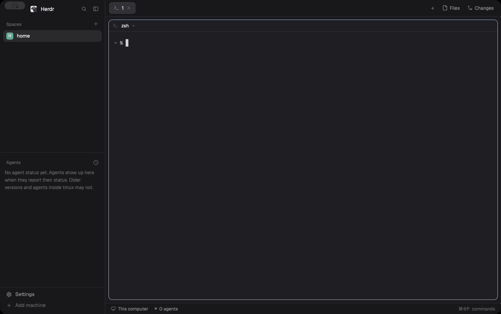
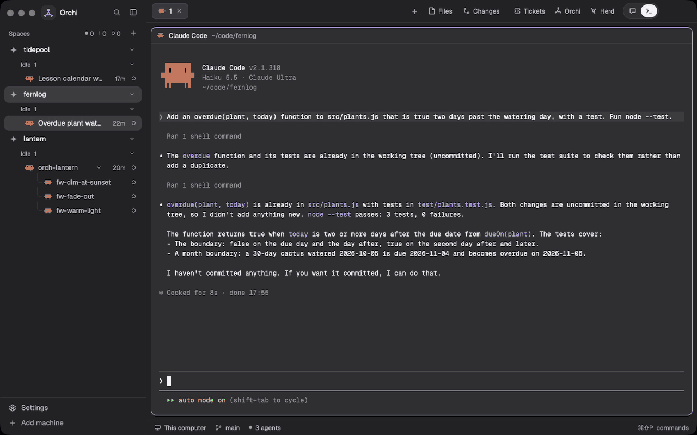
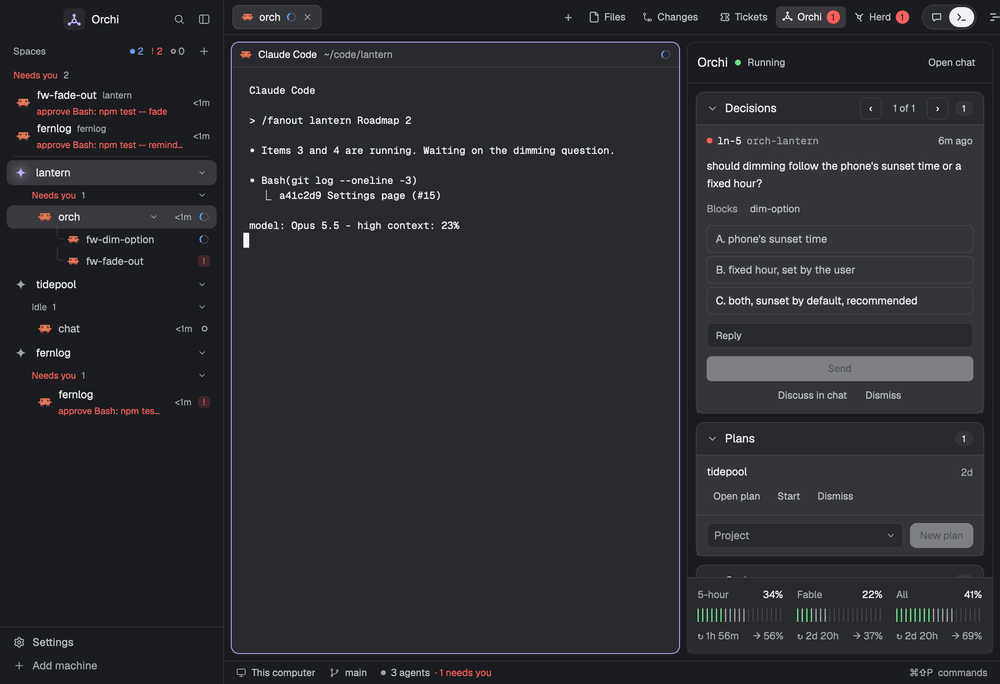
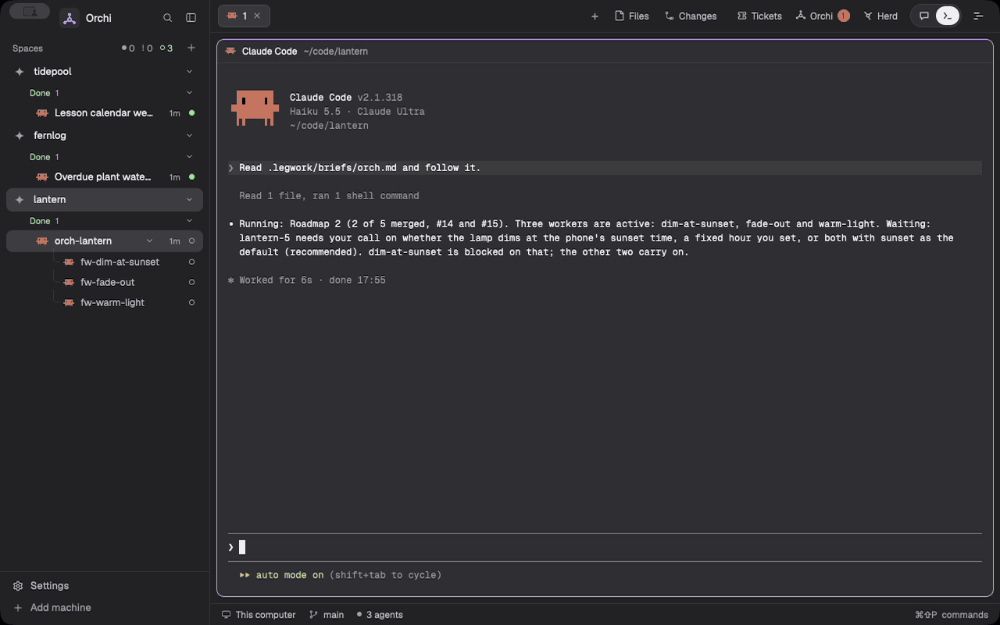
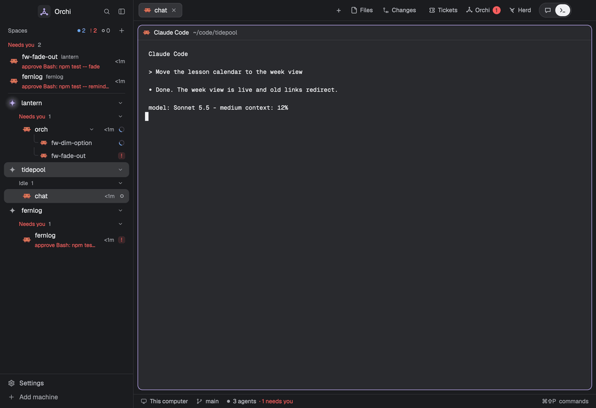
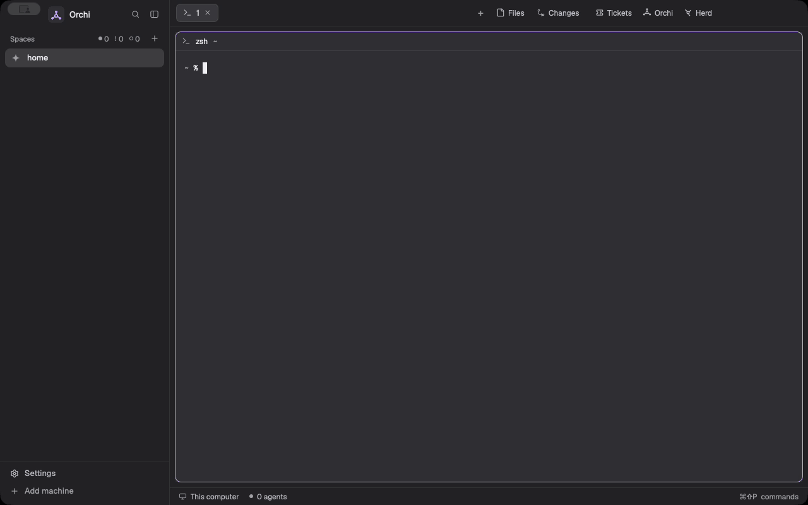
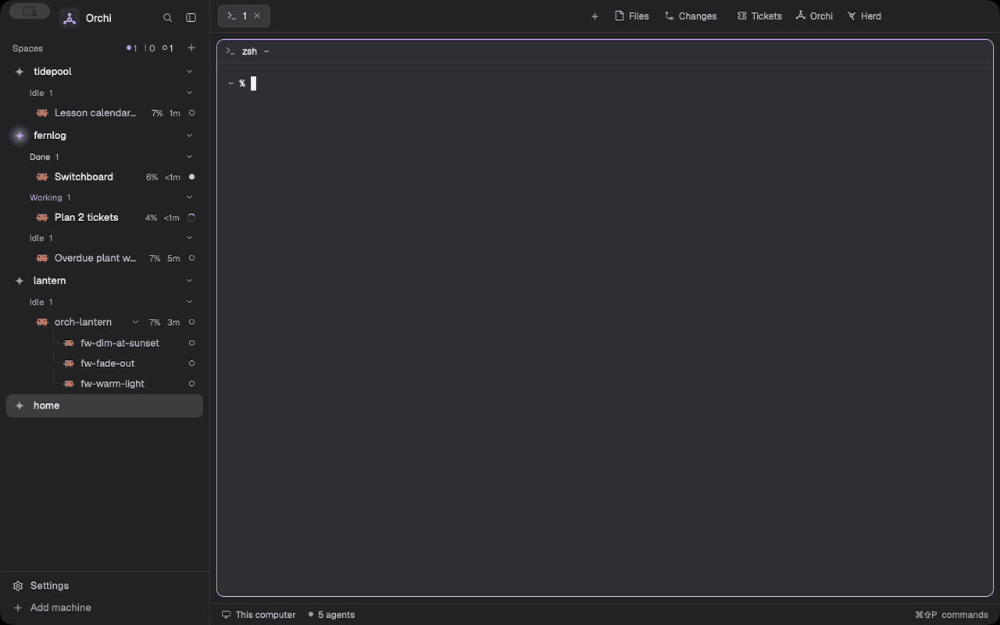

# Orchi

Orchi dresses the [Herdr](https://github.com/ogulcancelik/herdr) desktop app for running many Claude Code agents at
once: its own look, panels for tickets, agents and progress, and an orchestration layer that plans work, hands it to
agents and answers for you when they need a decision.

## Install

Orchi needs a Mac. Run this in a terminal:

```bash
curl -fsSL https://raw.githubusercontent.com/adamentwistle/orchi-build/main/install.sh | sh
```

It installs uv if you don't have it, then Orchi, then runs `orchi`. `orchi` asks before it installs anything, and ends
with Herdr showing Orchi. Run `orchi` again whenever something has drifted, and `orchi doctor` to only look. While the
repo is private, set `ORCHI_GITHUB_TOKEN` to a token that can read it.



## Update

```bash
orchi update
```

It moves to the newest release, says which version it moved from and to, then runs the steps so everything is fresh.
When you already have the newest, it says so and stops.

## Uninstall

```bash
orchi uninstall
```

It asks once, then removes the files, links, folders and launch agent that Orchi made. `--yes` skips the question. A
file you changed since Orchi wrote it stays, and the list at the end names it. These stay too: the backups in
`~/.local/state/orchi/backups`, your settings file when you changed it, the Linear key in the keychain, and the
programs setup installed.

Then remove the command itself:

```bash
uv tool uninstall orchi
```

## The window

### Spaces, agents and panels

The sidebar lists each space with its agents grouped by status, and anyone who needs you at the top. The header over a
terminal says what it is and when it needs you. The buttons in the tab bar open Tickets, Orchi and Herd. The toggle
beside them swaps a session between its terminal and the chat, and in an orchestrator's tab one more button opens its
progress pane.

### Tickets

Every chosen source's open tickets in one list. Open one to read it, tick a few, check the session's choices, then Go
starts the planner.



### Orchi and a run

The Orchi panel holds decisions, plans and the running orchestrators. The progress pane beside an orchestrator shows
its run task by task, and the plan pane shows a project's roadmap.



### Herd

Everything the session in view has started, on one map, with a row per worker.



### Chat

The chat pane reads a Claude Code session as a thread and sends what you type to it.



## Settings

Orchi reads `~/.config/orchi/settings.json` (`$ORCHI_SETTINGS` for the scripts). Every key can be left out, and then
its default holds. `src/orchi/settings.schema.json` is the schema. No secret ever goes in this file.

| Key | What it is | Default |
| --- | --- | --- |
| `claude_dir` | The Claude Code profile folder sessions Orchi starts run under | Claude Code's own, `~/.claude` |
| `orchi_dir` | Orchi's checkout | `~/orchi-build` |
| `legwork_dir` | The legwork tracker | none |
| `worker_limit` | Workers that can run at once, across every run, from 1 to 50 | `6` |
| `usage_guard_percent` | How full a usage limit gets, from 1 to 100, before usage-guard pauses a session | `95` |
| `sources` | The ticket sources planning reads: `legwork`, `github`, `linear`, `markdown` | `["legwork"]` |
| `github.own_owners` | GitHub users and organisations that are yours | none |
| `github.repos` | GitHub repos whose issues are tickets, as `owner/repo` | none |
| `github.command` | The command that runs gh, such as `gh-personal` | `gh` |
| `linear.teams` | Linear teams to pull in, by key | none, so the issues assigned to you |
| `linear.projects` | Linear projects to pull in, by id | none |
| `linear.repos` | The folder each Linear team works in, by team key | none |
| `linear.legwork_projects` | The legwork project each Linear project belongs to, by Linear project id | none |
| `markdown.paths` | Markdown task files, or folders of them | none |

Legwork is always a source. The Linear API key is never a setting: it is `LINEAR_API_KEY` when that is set, else the
keychain's generic password under the service `orchi-linear`. Until setup moves them, `workerLimit` in
`~/.config/herdr-app/orchi.json`, and `teams`, `repos`, `legwork.dir` and `legwork.projects` in
`~/.config/herdr-app/linear.json`, count for any of these keys the file leaves out.

## What's here

| Path | What it is |
| --- | --- |
| `themes/`, `scripts/build-themes.py` | Orchi's dark and light themes, and the script that builds them from its palette |
| `config/` | The Herdr settings that go with them, and the browser's entry in the + menu |
| `mods/` | The panels: chat, Herd, progress, Tickets, Orchi, the sidebar list and chrome, plan view |
| `layouts/`, `keys/` | The layout that holds the panels, and their keys |
| `sounds/` | The alert sounds, with their sources |
| `browser/` | The browser pane agents drive |
| `bin/` | The orchestration scripts: the switchboard, the herdr wrapper, hooks |
| `skills/`, `commands/` | The Claude Code skills and commands for planning and orchestration |
| `launchd/` | The switchboard's health watcher job |
| `docs/` | How each piece works, and setup |
| `tests/`, `bin/tests/` | The checks |

## Commands



```bash
uv tool install .             # install the `orchi` command from this checkout
orchi                         # put the themes, mods, layout, keys, sounds and browser pane into Herdr
orchi doctor                  # check them and change nothing
orchi update                  # move to the newest release, then set up
orchi uninstall               # remove what Orchi made
orchi tickets                 # the open tickets of every chosen source; --json for agents
orchi tickets show ENG-12     # one ticket by its reference
orchi tickets states ENG-12   # the states a Linear ticket can move to, in board order
orchi tickets move ENG-12 Done --comment "Merged"   # a write: asks first, or --yes; --dry-run to only look
orchi tickets sync legwork:birch --dry-run          # what /wrap's Linear sync would change
scripts/herdr-dev             # run a private Herdr for testing
node --test tests/            # the panels' checks
python3 -m pytest bin/tests pkgtests   # the scripts' and the package's checks
```



See `docs/setup.md` for the switchboard, and `docs/legwork-sync.md` for the line that hands legwork's Linear sync to
`orchi tickets sync`.

## Licence

MIT, see `LICENSE`. Parts come from other projects: see `NOTICE.md`.
