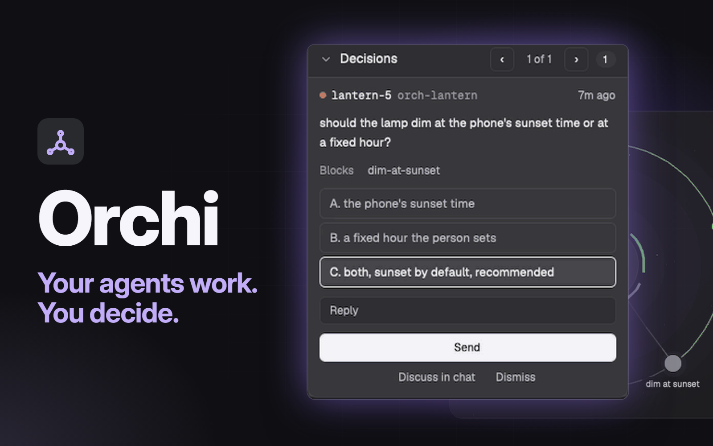

# Orchi

A window for running many Claude Code agents at once. The sidebar lists every space with its agents grouped by status, and anyone who needs you at the top. The tab bar opens three more panels: Tickets, Orchi and Herd. A toggle swaps a session between its terminal and a chat, and an orchestrator's tab gets a progress pane.



To use it, run the installer. The layout and mods alone can't run the orchestration behind the panels (see Watch out).

```bash
curl -fsSL https://raw.githubusercontent.com/adamentwistle/orchi-build/main/install.sh | sh
```

## What you see

Left to right, with the `orchi-dark` theme: canvas and chrome `#1b1c1f`, surface `#292a2e`, accent `#c2aef8`, Geist for the interface and Geist Mono in terminals.

- **Sidebar**, 268px, column, chrome background, 44 to 480px wide. A 46px brand row with Orchi's mark, a search button and a collapse button. Then the spaces list, filling what's left. Then a 69px footer with Settings and Add machine.
- **Tab row**, 42px. The shipped tabs, then a 344px block of buttons: Tickets, Orchi with a count of open decisions, Herd with a count of blocked agents, the chat and terminal toggle on a Claude Code session, and a progress button on an orchestrator's tab.
- **Main**, the active tab's panes. Radius 10, gap 8, a 1px `border` line that turns `accent` on focus, and a 30px header over each pane naming what it is, its folder and its status.
- **Panel**, right of main, hidden until a button opens it, 368px, 320px at least. A stack of Files, Changes, Tickets, Orchi and Herd.
- **Status bar**, 28px, the shipped `workspace-status`.

The Orchi panel has three cards. Decisions shows one question at a time with its options, a reply box and Send. Plans shows queued plans with Start. Orchestrators shows each run with its latest update, steps and workers.

## How it behaves

- **Working** is `#58a2fb`. A space's spark glows in the accent while an agent in it works, and the agent sits in a Working fold.
- **Blocked** is `#f95e5d`. The agent joins Needs you at the top of the sidebar with what it's waiting on, the doorbell plays, and an open question shows in Decisions.
- **Done** is `#60e385`. The agent moves to a Done fold and the done sound plays. A worker finishing plays one quiet note, once per 1.5 s.
- **Idle** is `#a1a3a9`, with an open ring.
- Chevrons fold a space or a status, and folds survive a restart. A press on a row focuses that agent. Spaces drag to reorder.
- A tab bar button opens its panel, and a second press closes it. The Herd panel's arrows take it full width. Opening another panel brings the terminals back.
- `ctrl-shift-j` swaps terminal and chat. `ctrl-shift-y` opens Tickets. `cmd-shift-u` jumps to the agent that has waited longest.
- Go on Tickets starts a planner. Start on a plan starts an orchestrator, one per repo, which hands tasks to workers in panes. A switchboard session watches them and brings decisions to the Orchi panel.

## Built from

- `layouts/orchi.json`, cloned from the shipped `main`. Root row of `sidebar` and `work`. `sidebar` holds `brand` and `sidebar-footer` (both `orchi-chrome`, the footer with `props: { footer: true }`) around `space-agents`. `work` holds `tabs-row` (`tabs`, `panel-buttons`), `work-body` (`main`, and `panel` with the `panel-body` stack) and `status`. `main`'s pane header is `pane-header`.
- Orchi's mods: `orchi-chrome`, `space-agents`, `panel-buttons`, `pane-header`, `tickets`, `orchi`, `herd`, `claude-chat`, `orch-pane`, `plan-view`, `linear-agent`.
- Shipped mods: `tabs`, `files`, `changes`, `workspace-status`. It also uses icons from `workspace-chrome` and `pane`.
- `herdr` functions: `exec`, `hc`, `run`, `layout`, `panes`, `terminals`, `agents`, `spaces`, `shared`, `setShared`, `playSound`, `openOverlay`, `nextCommand`. Commands: `layout.show`, `layout.hide`, `layout.select`, `layout.resize`, `pane.split`, `pane.zoom`, `pane.focus`, `agent.focus`, `mod.open`.
- Programs: `orchi`, `hc`, `python3`, `claude`, `zsh`, `sh`, `osascript`, `git`, and the switchboard scripts in `bin/`.
- Art: Orchi's mark in `mods/orchi-chrome/logo.svg`, and small SVG icons in each mod folder. Sounds and themes are in `sounds/` and `themes/`.

## Watch out

- **The gallery copy isn't enough.** Adding this layout copies `layouts/orchi.json` and the mods. It leaves out the `orchi` command, `bin/`, the skills, `keys/`, `sounds/` and `themes/`. Tickets and Orchi then have nothing to read. Run the installer, which adds all of it and asks first.
- **Mac only.** `main` uses `osascript`, `zsh`, `open` and launch agents. Nothing else has been tried on this branch.
- **What it does on your machine.** These mods run programs through `exec` and `hc`, read Claude Code transcripts, type into agent sessions, and reach the network through the ticket sources you choose. The installer adds launch agents for the usage and switchboard health checks.
- Its Herdr pieces expect `hc` and terminals reporting agent status. A session outside Herdr won't show.
- Shipped layouts refuse edits. Clone `main` first if you build this by hand.
- A panel missing from `shared("workspace.panels")` is closed by the tab bar on a space switch. `panel-buttons` adds its own at start.
- A mod can't import from another mod, so `settings.js` is copied into each one that needs it.
- The Tickets panel's Linear source needs a key of your own.

## Done when

- `orchi doctor` reports nothing to fix, and `herdr-app check` passes on each folder in `mods/`.
- The window shows the sidebar's spaces list, and the tab row shows Tickets, Orchi and Herd.
- Each of those three buttons opens its panel, and a second press closes it.
- On a Claude Code session, `ctrl-shift-j` swaps to the chat and back with the same pane id.
- A session waiting on a permission prompt appears under Needs you with what it's waiting on, and a press focuses it.
- Starting a plan opens an orchestrator tab with a progress button, and the Orchi panel lists the run.
